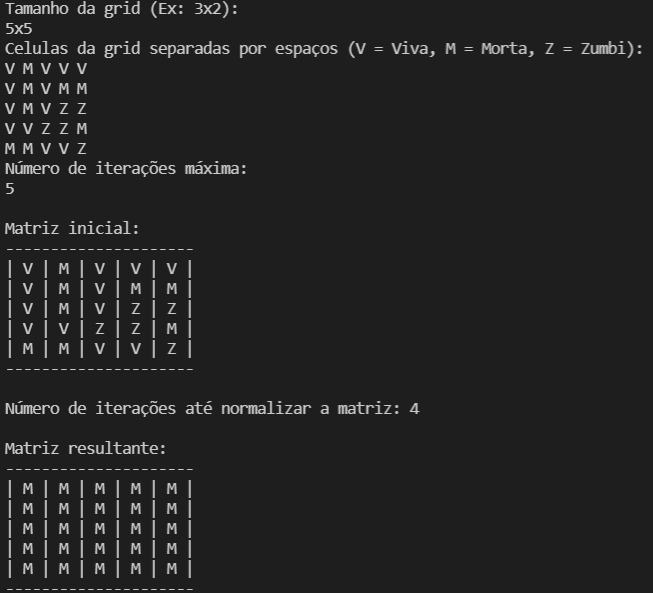

# GameOfLife

[Euller Macena](https://github.com/eullerm) ([LinkedIn](https://www.linkedin.com/in/euller-macena/)) · [Malkai Oliveira](https://github.com/MalkaiOliveira)

UFF - Niterói, 2021-2022

Projeto desenvolvido na matéria de Linguagem de Programação.

O jogo (autômato celular com células mortas, vivas e zumbis) é implementado em Haskell. O frontend em React conversa com esse motor por HTTP e foi desenvolvido por [Euller Macena](https://www.linkedin.com/in/euller-macena/).

# Stack

- Haskell - Linguagem funcional
- Visual Code - Editor de texto
- Stack - Ferramenta de build

# APP

O programa de console recebe do usuário o tamanho, a matriz inicial e o número de iterações. Retorna o número de iterações até a matriz normalizar e o resultado da mesma.



Caso alguma célula da matriz não seja passada o código inicia ela como morta.

## Instalação

Este app precisa do [Stack](https://docs.haskellstack.org/en/stable/README/) para funcionar.

Para Windows:

```sh
https://get.haskellstack.org/stable/windows-x86_64-installer.exe
```

Para Linux:

```sh
curl -sSL https://get.haskellstack.org/ | sh
```

### Testar

```sh
$ stack build
$ stack exec GameOfLife
```

# Casos de teste

Para o teste é possível iniciar o grid de qualquer tamanho desejado, por exemplo:

- 5x5
- 16X32
- 100x3

Sendo o primeiro valor a quantidade de linhas da matriz e o segundo de colunas, esses valores devem ser sempre separados pela letra **X** ou **x**.

Para criar a matriz é necessário que cada célula esteja separada por espaço e a cada nova linha ocorra uma quebra de linha, por exemplo:

```
V V V
M M M
Z Z Z
```

Caso alguma célula não seja iniciada o programa considerará ela como morta, por exemplo em uma matriz 3x3 dado o seguinte input do usuário:

```
V V V
Z Z
```

O programa criará a matriz da seguinte forma:

```
V V V
Z Z M
M M M
```

# Regras

Cada célula tem oito vizinhos (incluindo as diagonais); as bordas não "dão a volta" no tabuleiro. Em cada geração conta-se quantos vizinhos estão vivos (`a`) e quantos estão zumbis (`z`), e a célula é reclassificada segundo as regras abaixo.

- **Morta (`M`)** — célula vazia. Nasce como **Viva** quando tem exatamente 3 vizinhos vivos. Caso contrário continua morta (zumbis não afetam células mortas).
- **Viva (`V`)** — célula viva.
  - Se tiver **pelo menos 1 vizinho zumbi**, vira **Zumbi** (esta regra é aplicada antes das regras de morte).
  - Senão, se tiver **menos de 2** vizinhos vivos, morre (`M`).
  - Senão, se tiver **mais de 3** vizinhos vivos, morre (`M`).
  - Senão (2 ou 3 vizinhos vivos, sem zumbi por perto), continua **Viva**.
- **Zumbi (`Z`)** — célula infectada.
  - Se **não tiver nenhum vizinho vivo**, volta a ser **Morta**.
  - Caso contrário continua **Zumbi** (não morre por falta nem por excesso de vizinhos, e não transforma células mortas em zumbis).

O que uma célula zumbi faz com uma viva: um único zumbi vizinho **infecta** a célula viva, que vira Zumbi independentemente da quantidade de vizinhos vivos. Essa infecção tem prioridade sobre as regras de nascimento e morte — por isso uma célula morta com 3 vizinhos vivos ainda nasce normalmente, mesmo que também toque um zumbi.

# Frontend (React) + API local

O motor Haskell continua sendo o mesmo do trabalho (`core-haskell/src/GameOfLife.hs`). Para o frontend, ele também é exposto como um serviço HTTP local pelo executável `api`, e o React consome esse serviço.

O frontend foi desenvolvido por [Euller Macena](https://www.linkedin.com/in/euller-macena/).

São dois terminais:

Terminal 1 — backend Haskell (dentro de `core-haskell/`, ou pela raiz com `npm run api`):

```sh
$ cd core-haskell
$ stack build
$ stack exec api
```

O serviço sobe em `http://127.0.0.1:8787` (pode ser trocado pela variável `GOL_API_PORT`).

Terminal 2 — frontend (na raiz do repositório):

```sh
$ npm install
$ npm run dev
```

O Vite faz proxy de `/api` para o backend (veja `vite.config.ts`), então não há problema de CORS.

## API HTTP

| Rota | Método | Descrição |
| --- | --- | --- |
| `/api/health` | GET | Responde `ok` quando o serviço está no ar. |
| `/api/generation` | POST | Recebe `{ "cells": [[0,1,0], ...], "steps": 3 }` e devolve `{ "cells": ..., "iterationsUntilStable": 3, "stabilized": false }`. |

Regras de validação: grade retangular de até 200x200, células entre 0 e 2, `steps` entre 0 e 10000. Entrada inválida retorna 400 com `{ "error": "..." }`.

## Controles da tela

- **Clique numa célula** para alternar: Morta -> Viva -> Zumbi -> Morta.
- **Iniciar/Pausar** — roda uma geração a cada intervalo escolhido no controle de velocidade (padrão 500 ms).
- **Próxima geração** — avança um passo.
- **Rodar até estabilizar** — roda até o tabuleiro parar de mudar (até 500 passos) e informa em quantas iterações estabilizou.
- **Limpar** — zera todas as células.
- **Linhas/Colunas + Aplicar** — redimensiona a grade (1 a 60), preservando o que couber.

## Estrutura do frontend

```
src/
  core/transport.ts     fachada de acesso ao núcleo (hoje HTTP local)
  components/Board.tsx  tabuleiro em canvas
  App.tsx               estado da grade, controles e loop de reprodução
  index.css             estilos da aplicação
```

O acesso ao núcleo fica atrás de `CoreTransport` (`src/core/transport.ts`). Trocar a implementação (por exemplo, para uma versão WebAssembly do Haskell no futuro) não exige mudanças nos componentes.
